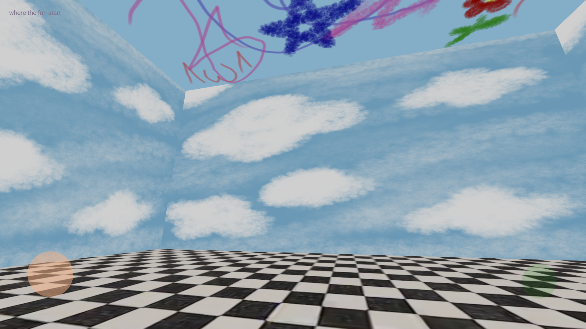

# MyVPetterra Project

myvpetterraproject is a web-based project, the concept is a world in a toy box. where user can take care the toys like pets. thought the pet is still missing, i havent make the pet yet.

# Why i make it
i want to learn more about javascript and i really like to make this interactive world i like play pet game and i like cute thing like toys

**Live demo:** [myvpetterraproject.vercel.app](https://myvpetterraproject.vercel.app)

## Current Features

- Click the closed box to open it and play a pop sound.
- Click the open box to enter the 3D room.
- Explore with W, A, S, D on desktop or the on-screen joystick on mobile
- Look around by dragging in the scene; jump with Space or the on-screen jump button.
- Room surfaces use image textures loaded from `public/asset/the world/`.

This is an early prototype focused on the entry interaction and room exploration. A virtual pet character and pet-care interactions are not implemented yet.

## Screenshot


[Watch gameplay](docs/game_play.mp4)

## Run Locally

Requirements: Node.js and npm.

```bash
npm install
npm run dev
```

Open the local URL printed by Vite. Run `npm run build` to create a production build.

## Controls

| Action | Desktop | Mobile |
| --- | --- | --- |
| Open the box / enter the room | Click the box | Tap the box |
| Move | W, A, S, D | On-screen joystick |
| Look around | Drag in the scene | Drag in the scene |
| Jump | Space | Jump button |

On supported mobile browsers, entering the room also requests fullscreen and landscape orientation. Browser and device support may vary.

## Built With

- JavaScript, HTML, and CSS
- [Three.js](https://threejs.org/) for 3D rendering
- [nipplejs](https://github.com/yoannmoinet/nipplejs) for the mobile joystick
- [Vite](https://vite.dev/) for local development and production builds

## Project Structure

```text
docs/
    game_play.mp4/
	screenshot.png/
index.html
public/
	asset/
		box/
		the world/
src/
	App.js
	App.css
package.json
README.md
```